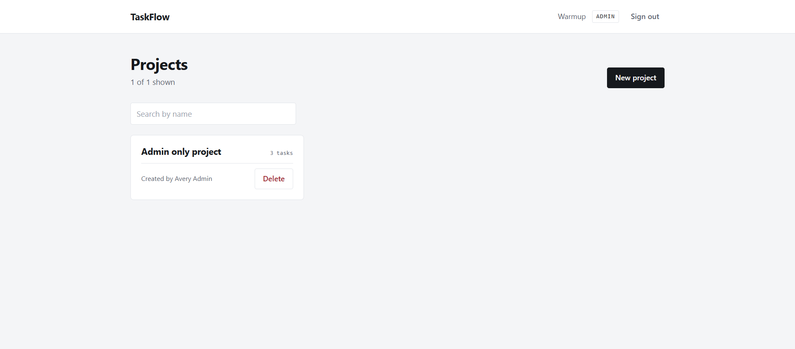
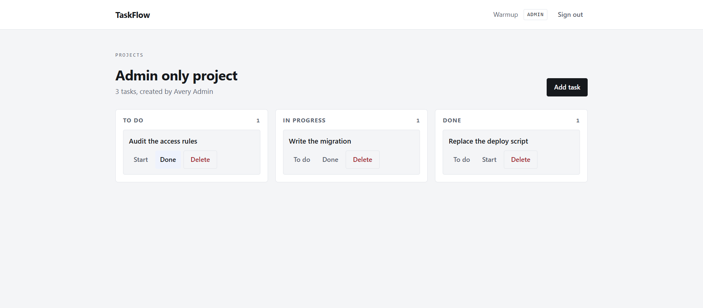
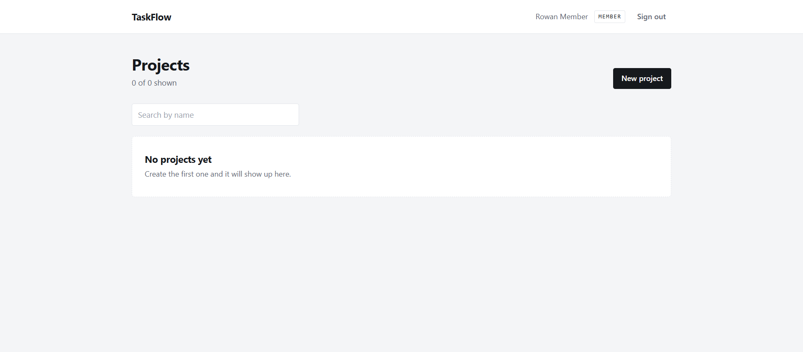

# TaskFlow

A full stack task manager. The point of it is the access control: three kinds
of user, and every rule about who may do what is written once in the service
layer and applied on the server.

**Stack:** React 19, TypeScript, Node.js, Express 5, PostgreSQL, JWT, Zod, Vitest, GitHub Actions

## What it does

- Register and sign in, with bcrypt hashed passwords and a seven day JWT
- Two roles, **admin** and **member**, and five things a user can or cannot do
- Projects and tasks, with a task belonging to a project and an optional assignee
- Search the project list, filter it, and add, rename and delete
- A task board in three columns: to do, in progress, done
- Validated forms, and loading, empty and error states on every screen
- Role based route guards in the browser, and the same rules enforced by the API
- 44 automated tests, and a CI run on every push





The same list as a member: no delete button, and none of the admin's projects,
because the API filtered them out rather than the interface hiding them.



## The roles

The rule is decided in one place, the service layer, and nowhere else. The
route handlers know how to read a request; the repositories know how to write
SQL; the services know who is allowed to do what.

| | admin | member |
| --- | :---: | :---: |
| Register and sign in | ● | ● |
| Create a project | ● | ● |
| See every project | ● | |
| See the projects they created or are assigned in | ● | ● |
| Rename a project | ● | ● |
| Rename somebody else's project | ● | |
| Delete a project and its tasks | ● | |
| Add a task | ● | ● |
| Move a task they are assigned | ● | ● |
| Move somebody else's task | ● | |

The role is never taken from the request. It is not part of the registration
schema, it is not part of the login schema, and it is not in the token: the
token carries a user id and nothing else, and the role is read from the
database on every request. A token signed before a role changed keeps the old
role alive until it expires, which is exactly the bug this avoids.

The first account to register is the admin. Every account after that is a
member. There is no way to ask for a different one.

## Running it

You need Node 20 or newer and a PostgreSQL database. The free one from
[Neon](https://neon.tech) takes about two minutes and needs no card.

```bash
git clone https://github.com/0535MANIDEEP/taskflow
cd taskflow
npm install
cp .env.example .env      # then paste in DATABASE_URL and JWT_SECRET
npm run dev               # the API on :3001
npm run dev:web           # the front end on :1234, in a second terminal
```

The front end calls `/api` on its own origin and the development server
forwards it to the API, so there is no environment variable to keep in step
between development and production.

## Running the tests

```bash
npm test
```

No database and no Docker. The server's vitest config sets `DB_DRIVER=memory`,
which makes the database module load [pg-mem](https://github.com/oguimbal/pg-mem)
instead of connecting to Postgres. pg-mem is an in-memory Postgres, and every
query the suite runs is the same SQL the app runs against a real database.

## Project layout

```
server/src/
  app.ts                  the Express app, built and exported separately so
                           the tests can drive it with supertest
  config.ts                the environment, read once
  db/
    schema.ts              the tables, the constraints and the cascades
    index.ts               the pool, or pg-mem under test
  repositories/            the only files that write SQL
  services/                the only files that know who may do what
  middleware/              authenticate, requireRole, validate, errorHandler
  routes/                  the HTTP shape
web/src/
  api/client.ts            every call to the API, in one place
  auth/AuthProvider.tsx    the session, read back from the API on a reload
  components/RequireRole   the same rule, on this side of the wire
  pages/                   sign in, register, the list, the board
```

## Decisions I made

**One rule, written once.** The access rules live in the services and nowhere
else. The routes know how to read a request, the repositories know how to
write SQL, and the services are the only layer that knows a member may not
delete a project they do not own. A rule that lives in two places is a rule
that will disagree with itself eventually.

**The role is read from the database, not from the token.** Putting the role
in the token is cheaper: no query on every request. It is also wrong, because
a token is a photograph of one moment and the database is the person. A role
change would not take effect until the old token happened to expire. One
indexed lookup per request is a fair price for a change that takes effect
immediately.

**Field level checks rather than route level ones.** A patch that renames a
task and moves it along is one request with two changes. Checking the route
would mean one blunt answer for a user who is allowed to do most of it. The
service decides per action instead, so the message says which one was
refused.

**A derived table for the creator's name.** This one looks like a pointless
extra pair of parentheses. The in-memory Postgres used by the tests keys the
output of a grouped query by the name of the column it came from rather than
by the alias it was given, so a query selecting both `p.name` and `u.name`
returns one `name`, and the wrong one. Renaming the column inside the derived
table keeps them apart. PostgreSQL handles the original form correctly, but
the alias costs nothing and makes the two drivers agree.

## Bugs I hit

**The build passed and the page was blank.** Not this project, but the reason
the render tests exist here too: a component that imports a name the module
does not export becomes `undefined` at runtime, and a bundler does not catch
it. Every endpoint is exercised through the real app in the test suite for the
same reason.

**The in-memory database and the real one disagreed.** Three of them, and all
three were the driver's fault rather than the query's: a correlated subquery
it cannot plan, two columns with the same name collapsing into one key under
a `GROUP BY`, and timestamps arriving as strings instead of `Date` objects.
Every one of them passed in production PostgreSQL and failed in the test
suite, which is the worst possible direction for a difference to show up in.
The fixes are in the repository files with the reasoning next to them.

**The first test run failed on a 409.** The in-memory database outlives a
single test inside a file, so the second test that registered the same
address got a conflict from the first one. Every test now starts from an
empty database, which also makes the "the first account is the admin" rule
mean the same thing in every test.

## What I would improve

- **A database that is not the in-memory one under test.** The suite runs
  against pg-mem, which is a real Postgres emulator but not a real Postgres.
  The next thing to add is a second run against a throwaway database, the way
  `applytrack` does it.
- **Refresh tokens.** The session token lasts seven days and cannot be
  revoked before it expires. A short lived access token and a longer lived
  refresh token, with a revocation list, is the usual answer.
- **Assigning a task by name.** An assignee is a user id, so the form asks
  for a number. A people picker would be the obvious next thing.
- **Activity history.** A task that changes status leaves no record of who
  changed it or when.
- **Rate limiting** on the sign in endpoint, which is where brute force
  actually matters.

## Licence

MIT
